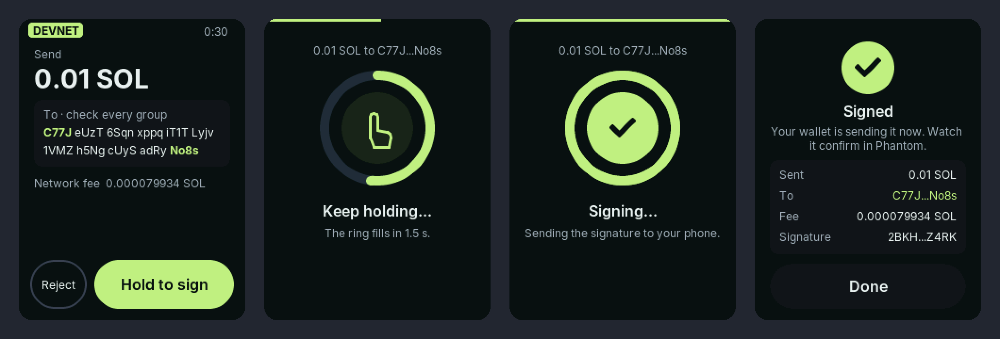
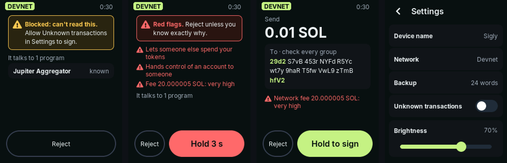
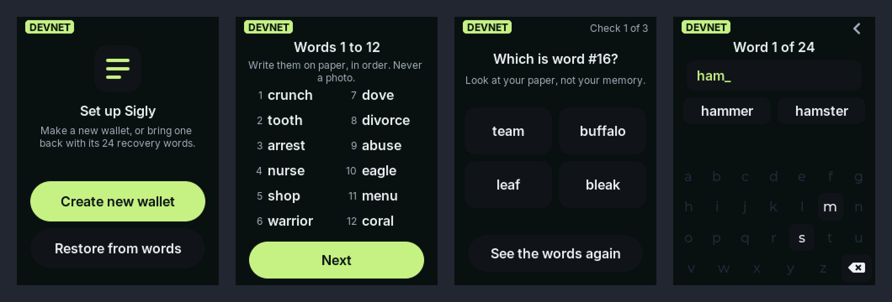
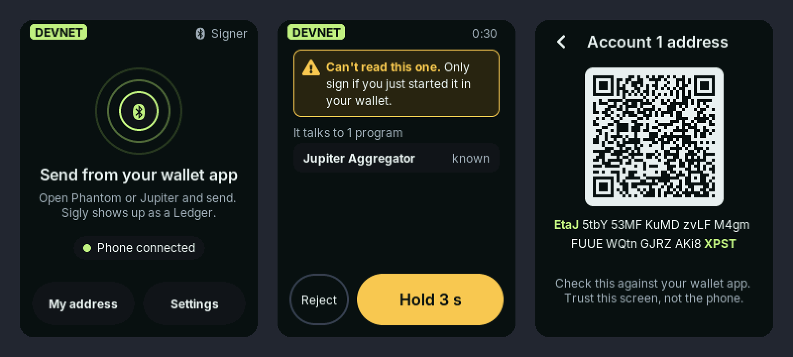

<p align="center">
  
</p>

# Sigly

<p align="center">
  
  
  
  
  
</p>

**A Solana hardware signer you can build for the price of a sandwich.**

Sigly is free, open-source firmware that turns a cheap ESP32 board into a Bluetooth
hardware signer. It speaks the open **Ledger Solana app protocol**, so wallets that
already support Ledger over Bluetooth work with it unchanged. Phantom and Jupiter
Mobile both connect, list your accounts and send through it today.

On the [Cheap Yellow Display](https://share.temu.com/XUkkYBght1B) (a ~$10 ESP32 board with a 2.8" touchscreen)
you see exactly what you are signing, then press and hold to approve. Your phone
never holds the key.

> **Not technical?** Installing the tools and flashing a board can be a hassle. I can
> buy a board, flash Sigly on it and mail it to you for a small fee (board, postage and
> a little for my time). Email me at [aleksandar@lll.mk](mailto:aleksandar@lll.mk)
> saying which country you're in and I'll reply with a price. Before posting, I power
> each board on and check that the screen, touch and Bluetooth work. It arrives with no
> wallet on it: you create your own recovery words on the device, so I never see them.

> Not affiliated with Ledger. "Ledger" is their trademark; this project only
> implements the publicly documented protocol.

---

## Status: devnet only

**Not safe for real funds yet.** On the CYD the seed is locked with your PIN
(Argon2id + XChaCha20-Poly1305) and backed up as 24 recovery words, but flash
encryption is not on yet: someone who takes the board and reads its flash chip could
try PINs on a computer, where the 3-try limit doesn't apply. Use devnet.

---

## What it does

### See what you sign

The sign screen decodes the transaction on the device, not on the phone:

- **Amount and recipient** for SOL transfers, with the full address in groups of
  four. The first and last four characters are highlighted, so you can check them
  against the address you meant to pay.
- **Network fee**, worked out from the compute budget instructions.
- **Unknown transactions** (swaps, NFTs, anything it can't read yet) are **blocked by
  default**: you see them and can only reject. Turn on *Unknown transactions* in
  Settings when you need a swap (and off again after). Then they get an amber warning,
  a list of the programs involved (Jupiter, Token, Token-2022, Memo and others are
  named) and a longer 3 second hold.
- **Red flags** in red, on top: a token *Approve* (someone else may spend your tokens
  later), *SetAuthority* or *Assign* (hands over an account), a *durable nonce* (the
  signature never expires) and a network fee above 0.01 SOL.

<p align="center">
  
</p>
- **Not a transaction at all?** It tells you to reject it.

### Press and hold to approve

A tap is not enough: you hold the button and a full-screen ring fills in 1.5 s
(3 s for unknown transactions). A thin bar at the top of the screen fills too, in
case your finger covers the ring. Let go early and nothing is signed. The BOOT
button only ever rejects, never approves.

### A receipt after signing

After you sign, the device shows what went out: amount, recipient, fee and the
transaction signature (the same id you'll see in the explorer). It stays up until
you tap Done.

### 24 recovery words

<p align="center">
  
</p>

- **New wallet:** Sigly shows 24 words (BIP39) once, on two pages. Write them on paper.
- **Backup check:** it then asks for 3 random positions ("Which is word #16?") and you
  tap the right word out of 4. Wrong answer: look at your paper and try again.
- **Restore:** type the words on an A to Z keyboard where letters that can't lead to a
  word are greyed out. After 2 to 4 letters you tap the word. A wrong word is caught by
  the checksum, and before choosing a PIN you see the address the words give, to
  compare with your wallet app.
- **Standard words:** the same words work in Phantom, Solflare or a Ledger
  (BIP39 → SLIP-10 `44'/501'/n'/0'`), so the backup is useful even without Sigly.
- **3 wrong PINs erase Sigly.** Your words bring the wallet back.
- A wallet from older firmware has no words (its seed was plain random bytes). After
  you unlock, Sigly offers a new wallet with words (new address) or "Later".

### More screens

<p align="center">
  
</p>

- **Idle:** connection status ("Phone connected" or "Waiting for your phone").
- **My address:** your account 1 address as a QR code, shown by the device itself,
  so you can check it against what the wallet app says.
- **Settings:** device name, network, backup status, brightness.

### Works with the wallets you already use

- Shows up as a Bluetooth Ledger running the Solana app.
- Derives addresses exactly like Phantom and Ledger (SLIP-10, `44'/501'/n'/0'`), so
  your accounts line up.
- Makes its recovery words from the ESP32 hardware RNG (with the radio on, so it is
  truly random).

---

## Hardware

| Blend | Board | Approve with | Status |
|---|---|---|---|
| `cyd` | Cheap Yellow Display (ESP32-WROOM, ILI9341 2.8" touch, no PSRAM) | Touchscreen: read it, then press and hold. BOOT rejects. | Working |
| `c3` | ESP32-C3 SuperMini / DevKitM (no screen) | BOOT button (blind signing) | Not built or tested yet |

> **The C3 blend signs blind.** With no screen, pressing BOOT means "sign whatever the
> phone sent". It still keeps the key off the phone, but if the phone is hacked it can
> swap the recipient or the amount and you will never see it. Use the C3 only for
> small amounts, or as a learning board. For real protection use a blend with a screen.

Where to get the CYD: the board used for development is [this one on Temu](https://share.temu.com/XUkkYBght1B).
Any "ESP32-2432S028R" Cheap Yellow Display should work; if the screen stays dark, check the
backlight pin (GPIO 27 here) in `platformio.ini`.

Both are Bluetooth-only: the classic ESP32 has no native USB and the C3's USB is a
fixed serial/JTAG port, so browser extensions (USB HID) can't talk to them. Mobile
wallets can.

---

## Try it

You need [PlatformIO](https://platformio.org/).

```bash
pio run -e cyd -t upload && pio device monitor     # or -e c3
pio test -e native                                 # unit tests, no board needed
```

Then in a mobile wallet: **Add hardware wallet → Ledger → Bluetooth**. Switch the
wallet to devnet, send a small amount, and approve it on the screen.

---

## How it's built

```
esp32-solana-signer/
├── src/
│   ├── ble_transport.*   # GATT service + Ledger BLE framing (0x05 frames, MTU query)
│   ├── apdu.*            # Solana app commands (E0 04 config, E0 05 pubkey, E0 06/07 sign)
│   ├── keys.*            # SLIP-10 derivation + Ed25519 (Monocypher)
│   ├── bip39.*           # 24 recovery words: word list, checksum, words -> seed
│   ├── pin_vault.*       # the seed locked with your PIN (Argon2id + XChaCha20-Poly1305)
│   ├── seed_store.*      # the vault in flash (NVS), wrong-PIN counter, wipe
│   ├── tx_decode.*       # reads the transaction: amount, recipient, fee, programs, base58
│   ├── ui_cyd.*          # CYD screens in LVGL 9 (sign, hold, receipt, idle, address)
│   ├── approve.*         # BOOT-button approval (C3)
│   ├── fonts/            # Inter, generated by scripts/make_fonts.sh
│   └── main.cpp          # glue
├── lib/monocypher/       # Ed25519, vendored
├── test/                 # Unity tests (APDU, transaction decoding, vault, BIP39 vectors)
└── platformio.ini        # cyd, c3 and native environments
```

| Layer | Detail |
|---|---|
| Board | ESP32-WROOM (CYD), ESP32-C3 |
| Bluetooth | NimBLE-Arduino 2.x, Ledger Nano X GATT profile |
| Crypto | BIP39, SLIP-10, Ed25519, Argon2id via Monocypher 4 |
| Screen | TFT_eSPI + LVGL 9.2, Inter fonts, XPT2046 touch on the shared SPI bus |
| Tests | Unity on the host (`pio test -e native`) |

---

## Security: what Sigly protects you from (and what it doesn't)

Sigly sits between a hot wallet (key on the phone) and a Ledger (key in a secure
element). It is a cheap, open, partial Ledger replacement and a phone or PC companion
that protects you better than a warm wallet. It is **not** as strong as a Ledger. Here
is where the lines are.

**A hacked phone.** Treat everything on the phone screen as a lie: malware can swap an
address in the clipboard, draw over Phantom, or ship a fake wallet app. It still can't
read your key (that never leaves the board) and it can't sign without your thumb on the
screen. What protects you is **reading the Sigly screen**:

- Check the recipient against where the address came from (the QR code, the person,
  the shop's site on another device), not against the phone.
- Unknown transactions are blocked by default. Turn them on only when you need them.
- Red flags (Approve, SetAuthority, Assign, durable nonce, high fee) mean "reject
  unless you know exactly why". A program can also do these things *inside itself*,
  where Sigly can't see it: that's why unknown transactions are blocked, not just
  flagged.

**A fake or tampered firmware.** Anyone can build a "Sigly" that looks the same and
sends your words or PIN out over Wi-Fi (the ESP32 has a Wi-Fi radio built in; this
firmware never turns it on). So:

- Build it yourself from this repository, or download it only from this repository's
  Releases page (once there are releases) and check its SHA-256 checksum against the
  one published there.
- Never install a Sigly firmware someone sends you, and don't buy a board that comes
  "with Sigly already on it" from a stranger: flash your own. The one exception is a
  board ordered from this repository's author by email (see the top of
  this page). Even then, once you're comfortable, you can re-flash it yourself from
  this repository and create new words.
- Firmware can only get onto the board over the USB cable. There is no update over
  Wi-Fi or Bluetooth.

**A lost or stolen board.** The seed is locked with your PIN (Argon2id +
XChaCha20-Poly1305). But flash encryption is not on yet, so someone with the board can
copy the flash in seconds and try PINs on a fast computer, where the wrong-PIN limit
doesn't apply. A short PIN falls quickly. Keep real funds on a Ledger until flash
encryption and secure boot are done, and move funds with your recovery words if the
board goes missing.

**The board itself.** Cheap ESP32 boards come from many sellers. The realistic risk is
not a hidden "phone home" chip (that costs money and would be visible), it's someone
putting different firmware on it, which is why you flash your own. You can check:
scan with a Bluetooth app such as nRF Connect (you should see only Sigly) and watch
the board's current with a USB meter (Wi-Fi sending shows as spikes above 200 mA).

**A lab attacker.** The ESP32 is an ordinary chip, not a secure element. Researchers
have broken secure boot and flash encryption on both the classic ESP32 and the C3 with
voltage-glitching equipment. With your board on their bench and time, a skilled
attacker can get the key. A Ledger is built to resist exactly that.

---

## Roadmap

1. **Probe:** do Phantom and Jupiter accept it? *(done)*
2. **Single key:** real Ed25519 key, approval, devnet. *(done)*
3. **CYD touchscreen:** see what you sign, press and hold, receipt. *(done)*
4. **Protect the seed:** PIN + encryption *(done)*, 24 recovery words and wipe after
   3 wrong PINs *(done)*. Later, a second key half sent from the phone as a short sound
   chirp to a microphone on the board. Flash encryption last.
5. **Dashboard mode:** lock screen, portfolio, activity and prices over Wi-Fi,
   brightness setting, a "≈ $" value on the sign screen.
6. **More decoding:** SPL token transfers and common swaps, so fewer transactions
   show up as unknown.
7. **Hardening:** Bluetooth pairing confirmed on the screen (only your phone can
   connect), longer passphrases instead of a PIN, signed releases with checksums,
   reproducible builds, then secure boot and flash encryption.

---

## Licence

MIT, see `LICENSE`. Bundles Monocypher (`lib/monocypher`, CC0 / BSD-2-Clause) and the
Inter font (`src/fonts`, SIL Open Font Licence).
